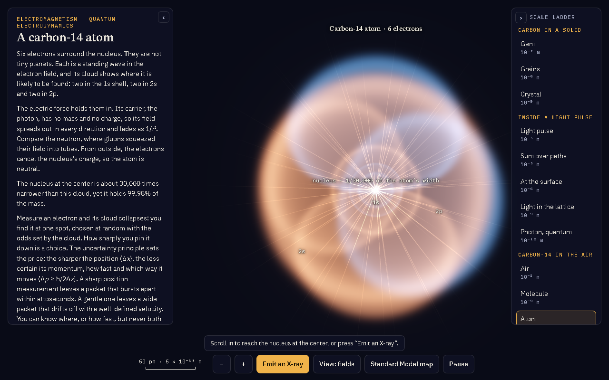

# Scale of Matter Zoom

**[Open the live app →](https://asarabiapersonal.github.io/scale-zoom/)**

An interactive 3D model of physics across scales. Zoom (on a log scale) from a W boson vertex inside a
neutron, out through the carbon-14 nucleus and atom, a CO₂ molecule and a cube of air; into carbon as a
solid (diamond and graphite lattices, crystal grains, a cut 1-carat diamond); and into light travelling
through air, glass and diamond, down to single photons and Feynman's sum over paths.

The physics uses real constants and published models, and every simplification is stated on screen in
plain language.



## What's inside

- **Down the scales:** weak-force vertex (W boson) → inside a neutron (quarks, gluon flux tube) →
  carbon-14 nucleus → carbon-14 atom (orbitals, plus "measure an electron": cloud collapse and the
  uncertainty principle) → CO₂ molecule → a cube of air.
- **Carbon in a solid:** diamond vs graphite lattice → crystal grains → a round brilliant diamond with
  ray-traced light.
- **Light:** a pulse through air, crown glass and diamond (real refractive indices, Fresnel reflection,
  angle of incidence, s/p polarization, Brewster angle, emission lines of H, Na and Hg); how light really
  slows down in a material (Ewald–Oseen); Feynman's sum over paths and the two-slit experiment with single
  photons; the photon as a quantum.

## Controls

| Action | Mouse / keyboard | Touch |
|---|---|---|
| Rotate | drag | one-finger drag |
| Zoom | scroll wheel, `+` / `−` buttons | pinch |
| Pan | middle-drag or Shift-drag | two-finger drag |
| Recenter | `0` or double middle-click | double-tap |
| Hide panels | `I` (info), `L` (levels), `H` (both) | panel tabs |

Jump to any level with the scale ladder on the right.

## Running it

It is a single static file, `index.html`, with Three.js r128 loaded from cdnjs. Open it in a browser, or
serve the folder:

```
python -m http.server
```

No build step, server code or keys are needed. GitHub Pages serves it straight from the `main` branch.

## Checks

```
npm i three@0.128.0                                    # local copy of three.js for offline test runs
pip install playwright && python -m playwright install chromium
python tools/shot.py                                   # screenshots every level to shots/, prints page errors
python tools/preview.py                                # regenerates assets/preview.png and assets/screenshot.png
```

See [`CLAUDE.md`](CLAUDE.md) for the full project brief: architecture, where everything lives in the file,
the physics models and the roadmap.

## Sources

Models and constants are cited in code comments and panel text. The main ones:

- **Refractive indices:** dry air, Peck & Reeder (1972); crown glass, Schott N-BK7 Sellmeier coefficients;
  diamond, Sellmeier fit after Peter (1923).
- **Light in matter:** Ewald–Oseen extinction theorem, as explained in *The Feynman Lectures on Physics*,
  Vol. I, ch. 31; Fresnel equations and Snell's law.
- **Sum over paths:** R. P. Feynman, *QED: The Strange Theory of Light and Matter* (1985).
- **Emission lines:** NIST Atomic Spectra Database (H, Na, Hg).
- **Atomic orbitals:** hydrogen-like orbitals with Clementi–Raimondi effective nuclear charges
  (1s 5.67, 2s 3.22, 2p 3.14).
- **QCD vacuum and flux tubes:** Leinweber et al., lattice QCD visualizations
  ([arXiv:1903.08308](https://arxiv.org/abs/1903.08308)); Bissey et al., flux tubes in baryons
  ([arXiv:hep-lat/0606016](https://arxiv.org/abs/hep-lat/0606016)).
- **Diamond cut:** Marcel Tolkowsky, *Diamond Design* (1919).

Built with [Three.js](https://threejs.org/) r128 (MIT license).

## License

[GPL-3.0](LICENSE). You may use, change and share this project, but anything you distribute that builds on
it must also be released under the GPL.
